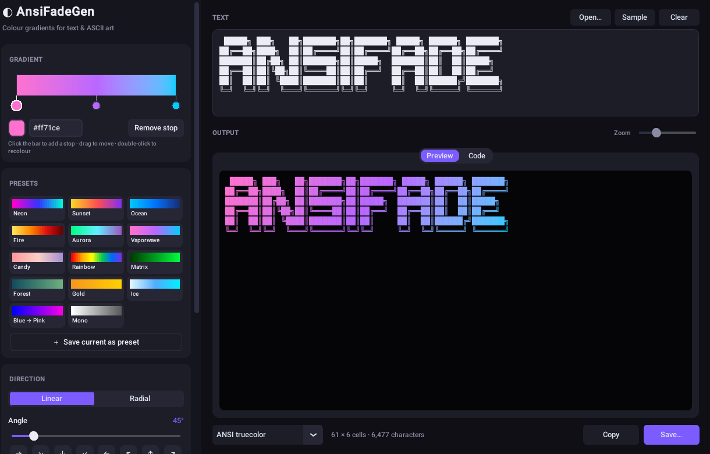

# ◐ AnsiFadeGen

**Colour gradients for text and ASCII art**: in a modern desktop app, on the command line, or from Python.
Export as ANSI (truecolor / 256 / 16), Discord, HTML, SVG or PNG.

<p align="center">
  
</p>

## Features

- **Visual gradient editor**: click the bar to add a colour stop, drag to move it, double-click to recolour. Any number of stops.
- **14 built-in presets** and your own (saved with their stop positions).
- **Any angle**, or a **radial** gradient. A *cell ratio* setting corrects for terminal cells being about twice as tall as wide, so a 45° gradient really looks like 45°.
- **Colour blending in sRGB, linear light or OKLab.** OKLab avoids the muddy mid-tones you get blending e.g. yellow → blue in plain sRGB.
- **Solid background**, reverse, live preview, zoom.
- **Exports:** ANSI truecolor, ANSI 256, ANSI 16, Discord ` ```ansi ` block, HTML, SVG, PNG. Copy or save.
- Compact output: blanks are never coloured and identical neighbours share one escape code.
- Unicode-safe: wide (CJK) characters, combining marks and tabs are measured in real terminal columns, and text that already contains ANSI codes is cleaned first instead of being corrupted.
- Reads colours as names, `#rgb` / `#rrggbb`, or `R,G,B`.

## Install

Python 3.9+.

```bash
pip install "ansifadegen[gui]"      # app + CLI   (customtkinter)
pip install "ansifadegen[all]"      # + PNG export (Pillow)
```

From a clone:

```bash
git clone https://github.com/sh4rk0000/AnsiFadeGen.git
cd AnsiFadeGen
pip install -e ".[all]"
python main.py        # launches the app
```

Tkinter must be available (it ships with Python on Windows and macOS; on Debian/Ubuntu: `sudo apt install python3-tk`).

## Desktop app

```bash
ansifadegen-gui          # or: ansifadegen --gui   or: python main.py
```

Shortcuts: `Ctrl+O` open a file · `Ctrl+S` save · `Ctrl+Shift+C` copy the output.

## Command line

```bash
# pipe text in, ANSI out
echo "Hello" | ansifadegen -c red,#00ff88,blue

# a file, a preset, an angle, written as HTML
ansifadegen logo.txt -p Vaporwave -a 90 -f html -o logo.html

# radial gradient, OKLab blending, solid background, PNG
ansifadegen logo.txt -c yellow,blue -m radial --space oklab --bg "#101018" -f png -o logo.png
```

| Option | Meaning |
|---|---|
| `-c, --colors` | `red,#00ff88,255,0,128,blue` (default `blue,pink`) |
| `-p, --preset` | a built-in preset name instead of `--colors` |
| `-a, --angle` | degrees: `0` left→right, `90` top→bottom, default `45` |
| `-d, --direction` | `horizontal` / `vertical` / `diagonal` (shortcut for the angle) |
| `-m, --mode` | `linear` or `radial` |
| `--aspect` | cell height ÷ width, default `2.0` |
| `-r, --reverse` | reverse the gradient |
| `--space` | `srgb`, `linear` or `oklab` |
| `--bg` | background colour |
| `-f, --format` | `ansi`, `ansi256`, `ansi16`, `discord`, `html`, `svg`, `png` |
| `-o, --output` | write to a file instead of stdout |

## Python

```python
from ansifadegen import apply_gradient

print(apply_gradient("Hello, world", ["#ff00cc", "#3333ff", "#00ffd5"], angle=0))
```

Lower-level pieces (`Gradient`, `compute_grid`, `render`) are exported too: the colour of every cell is computed once, in a GUI-free engine, and every output format renders that same grid.

## How it works

For a linear gradient at angle θ, a cell at position **p** (columns × rows·ratio) gets

```
t = ( p·d − min ) / ( max − min ),     d = (cos θ, sin θ)
```

where *min* and *max* are the projections of the four corners of the text's bounding box, so `t` spans exactly `[0, 1]` at any angle. The colour is the piecewise-affine interpolation of the stops at `t`, in the chosen colour space. A radial gradient uses the normalised distance to the centre instead.

## Development

```bash
pip install -e ".[dev]"
pytest                # GUI tests are skipped without a display
xvfb-run -a pytest    # headless Linux: runs the GUI tests too
ruff check .
```

## Notes

- The on-screen preview of very large texts (thousands of distinct colour runs) is slightly simplified to stay responsive; copies and exports always use exact colours. The status bar says when this happens.
- Discord's `ansi` blocks only support 8 colours, so gradients are quantised heavily in that format.

## Licence

MIT
